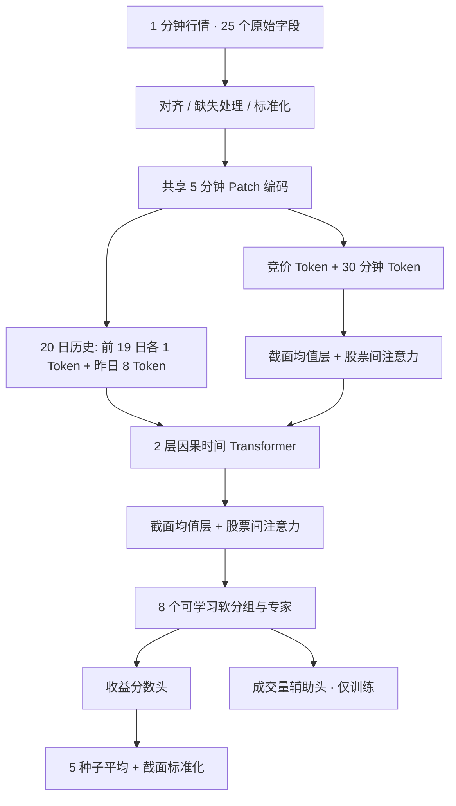
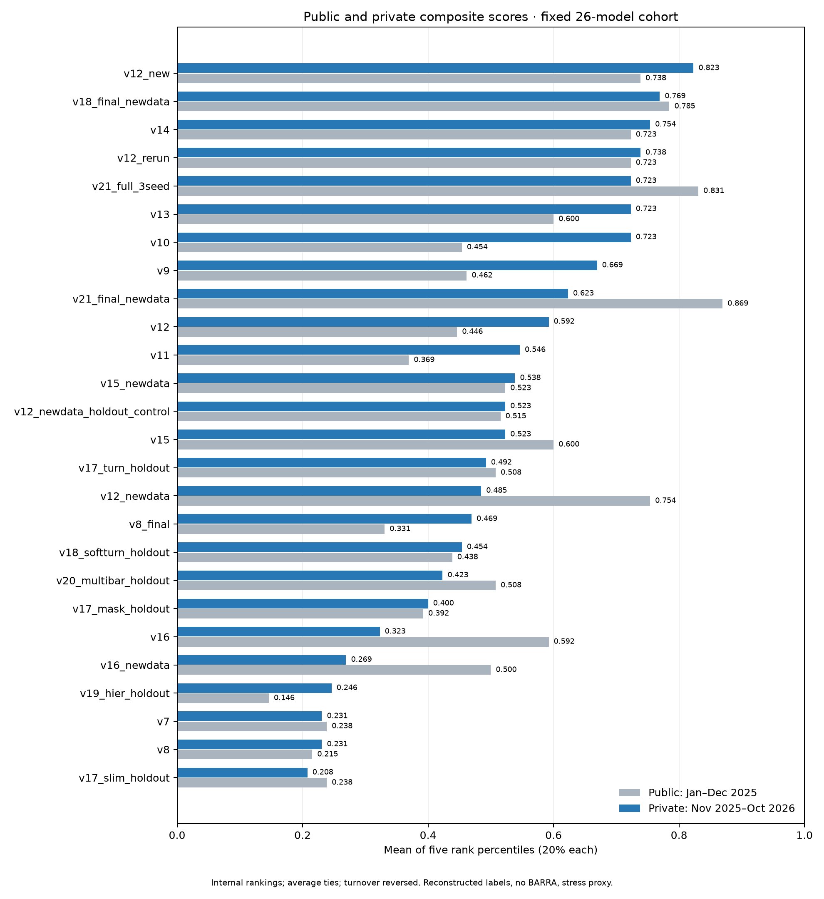

# RawFormer · 进益资本杯端到端模型

## 比赛与评判方式

[进益资本杯 · 端到端赛道（BigQuant 官方）](https://bigquant.com/square/competition/45b41c7a-0ac8-42e9-9fe3-0c33dcfb9bca)

- 任务：利用原始分钟级行情和盘口序列，预测未来 30 个交易分钟的 VWAP 收益，在指定时点输出股票分数。
- 端到端要求：允许对齐、补缺、标准化和切窗；不使用人工技术指标作为输入，预测只能读取当时及以前的信息。
- 平台统一处理因子，包括去极值、标准化和 BARRA 风格剔除。五项指标各占 **20%**，按全体有效提交中的排名百分比合成得分；换手率越低越好，其余四项越高越好。具体以官方规则和评测器为准。

IC 均值衡量预测排序与未来收益的相关性；IC_IR 衡量这种相关性的稳定程度；换手率反映持仓变化；Sharpe 衡量收益风险比；压力稳定性反映压力情景下的表现。判断泛化能力还应看未参与训练的时间段，以及不同月份是否持续有效。

## 比赛结果

**比赛最终排名：10 / 57 · 公榜：0.84 · 私榜：0.71**（最终提交版本：**v12_rerun**；成绩由参赛者提供）。

这次比赛中，我们持续迭代了多个模型，并在赛后对全部 **26 个版本**进行了统一复盘。结果发现：**v12_new 在本地重建的私榜窗口中综合表现最好**，后续迭代也没有超过它。可惜最终提交的是 **v12_rerun**（架构没变，重新训了一遍），没能把表现最好的版本带到最终提交中。这个仓库选择整理和保留 v12_new 的架构与训练方法。

**v12_new**从原始分钟行情直接学习股票截面预测分数，包含模型、从零训练和推理入口。仓库仅包含代码、模型配置元信息和汇总图表，**不包含比赛数据或预训练权重**。


## 模型结构



每个种子 **244,810** 个参数；隐藏维度 64、4 个注意力头、FFN 128、dropout 0.1。历史价格和成交量按复权因子对齐；复权因子不作为预测通道。所有 5/30 分钟表示都由 **1 分钟输入在网络内部**生成，无需额外频率数据。学习到的跨股票交互不使用行业或 BARRA 暴露。

训练标签先做截面秩到正态分位的变换，损失为：

```text
−mean(IC) + 0.5 × std(IC)
−0.06 × 相邻截面预测相关性 −0.5 × 成交量辅助预测 IC
```

## 数据与训练

需要有权限的官方数据，或对应的本地 Parquet 导出。数据从[进益资本空间](https://jinyicapital.bigquant.com/)获取，本仓库不分发数据。

| 数据表 | 本地文件 / 同名分片目录 | 用途 |
|---|---|---|
| `cpt_jyc_2026_stock_bar1m` | `bar1m.parquet` / `bar1m/` | 1 分钟量价与盘口 |
| `cpt_jyc_2026_instruments` | `sections.parquet` / `sections/` | 截面时间与股票名单 |
| `cpt_jyc_2026_vwap` | `labels.parquet` / `labels/` | `vwap_return` 与辅助目标 `volume`；仅训练 |

三张表都有 `date`（无时区 timestamp）与 `instrument`（字符串）。行情另需 `adjust_factor` 和 `train.BAR_COLS` 中固定顺序的 25 个字段：OHLC、三档买卖价、成交量额、三档挂单量、成交笔数及三档委托笔数。标签定义为未来 30 个交易分钟窗口的 `end_price / VWAP - 1`，午休不计入交易分钟；`volume` 为同一未来窗口的成交量。缺少辅助成交量列时，代码可退回主任务训练，但不再是完整 v12_new 配方。

原版训练区间为 **2020-01-01 至 2024-12-31**，每种子 4,000 步，种子 `42–46`；每批 8 个交易日，AdamW，最大学习率 `1e-3`，weight decay `1e-2`，OneCycleLR。日期均匀抽样，训练区间不会随推理日期改变。预处理自动向前读取 45 个日历日作为历史缓冲；有数据时应一并提供。

```bash
# Python 3.11；先安装与本机 CUDA 匹配的 PyTorch，再安装其余依赖
pip install -r requirements.txt

# 本地导出的数据目录；在具有 DAI 权限的平台环境中运行则省略此项
export JY_DATA_DIR=/absolute/path/to/your/private/data

# 使用原版固定参数训练五种子，输出权重和结构信息
python train.py --model-path model.json

# 独立推理，不会自动训练；输出 date / instrument / factor
python predict.py --model-path model.json \
  --start-date 2025-01-01 --end-date 2025-12-31 \
  --output outputs/factors.parquet

# 无需比赛数据或平台账号的合成验证
python -m unittest discover -s tests -v
```

平台入口为 `test.main(datasources, start_date, end_date)`，`datasources` 示例为 `{"bar1m": "cpt_jyc_2026_stock_bar1m"}`；提交文件包含 `test.py`、`predict.py`、`train.py`、`runtime.py` 和训练生成的 `model.json`。推理不读取标签表。平台评测可在其环境中调用 `M.jyc_eval._latest(factor_data=..., show=True)`。

## 五项指标与版本对照

以下是 **v12_new 的本地样本外复盘**，不是官方最终五项成绩。标签由 1 分钟数据重建，未做 BARRA 中性化，压力稳定性使用代理场景；因此不能与页首官方榜单综合分直接换算。

| 本地复盘窗口 | IC_IR↑ | IC均值↑ | 换手率↓ | Sharpe↑ | 压力稳定性↑ |
|---|---:|---:|---:|---:|---:|
| 2025-01—2025-12 （公榜） | 1.7363 | 0.1326 | 0.4524 | 55.3156 | 1.5497 |
| 2025-11—2026-10 （私榜） | 1.3074 | 0.1161 | 0.4499 | 39.4897 | 1.0976 |




图中分数是在固定 **26 个内部模型版本**之间对五项排名百分比等权平均，随对照集合变化，百分比分数也会变化。精确指标见 [results/metrics.json](results/metrics.json)，原始模型配置、训练记录和权重校验值见 [results/reference.json](results/reference.json)。